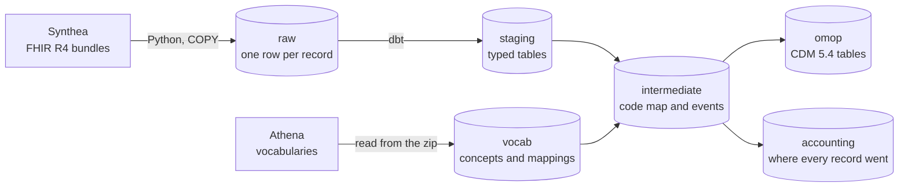

# FHIR to OMOP

Turns health records in FHIR, the format systems use to exchange them, into the OMOP Common Data Model, the format researchers use to analyse them. Every record is accounted for, so the output can be trusted before anyone asks a question of it.

All patients are synthetic, generated by [Synthea](https://github.com/synthetichealth/synthea). No real patient data is used anywhere.

> **Status.** The pipeline runs from raw FHIR to OMOP 5.4 for 1,133 synthetic patients. On top of it, five simulated trusts train a shared model with federated learning, without any patient record leaving a trust.

## Results

| Measure | Result |
|---|---|
| FHIR records in the source files | 1,400,153 |
| Records in Postgres after loading | 1,400,153 |
| Loaded into OMOP tables | 898,876 |
| Used to read another record | 16,351 |
| Left out, each type with a written reason | 484,926 |
| Clinical rows on a standard concept | 99.86% |
| Distinct codes on a standard concept | 1,154 of 1,180 |

## How it works



**Raw.** Each record is stored as published, with one row per bundle entry. A file is replaced in one transaction, so a rerun gives the same table, and a file only counts as loaded when the row count in Postgres matches the count in the file.

**Vocabularies.** The Athena download is 4.9 GB unzipped and most of it covers vocabularies this data never uses. The loader reads straight from the zip and keeps only what is needed, so nothing is unpacked to disk.

**Mapping.** Each source code becomes the standard OMOP concept it maps to. A code with no standard concept stays in its table with concept 0 and its original code, so the fact is not lost.

**Routing.** OMOP places a record by what its concept is, not by what FHIR called it. In this data, 21,523 "conditions" are really observations, such as employment status, and 302 "procedures" are really drugs given, mostly vaccines. Allergies are the exception. An allergy's code names the substance, so routing by concept would record a penicillin allergy as a dose of penicillin. Every allergy goes to the observation table instead, with the substance as its value.

**Accounting.** Every FHIR resource type is loaded, used to read another record, or left out with a reason. A new type with no decision fails the build, and so does a loaded type that loses rows.

## Federated learning

Hospitals often can't pool patient records, so each one trains on far fewer patients than it could. Federated learning sends the model to the data instead. Each site trains on its own patients, and only the learned weights travel back to be averaged. OMOP is what makes this possible, because every site stores its data the same way.

**The question.** How much does a trust gain by joining a federated model, and how much does it give up compared with pooling all the data?

**The task.** Predict whether a patient will have an emergency visit in the next year. Readmission was the first idea, but only 1 of 37 admissions in a sample was followed by another within 30 days, which is too rare to predict. Emergency visits happen to 13% of patients a year. That gives 7,626 patient-years from 1,015 people, and 993 cases.

**The features.** There are 34 inputs, such as age, past visits, diagnoses, blood pressure and BMI. All of them come from the OMOP tables only, and all from before the prediction date, so the same query would run at any OMOP site. A test checks the time windows line up, so future data can't leak in.

**The three methods.** All three use the same logistic regression and the same training code, so the only difference is where the data sits.

| Result (AUROC, higher is better) | One trust alone | Federated | All data pooled |
|---|---|---|---|
| Trusts split by region | 0.650 | 0.676 | 0.681 |
| Trusts split by age, so they differ on purpose | 0.650 | 0.681 | 0.681 |

- **Federated beats a trust working alone.** The gain is 0.013 to 0.041 by region and 0.016 to 0.046 by age, with 95% confidence. All five trusts gained in both splits.
- **It gives up very little.** Federated trails pooling by 0.002 to 0.009 by region. In the age split the difference is 0.002 or less either way.
- **The model itself is modest.** An AUROC of 0.68 is a modest score. The comparison between methods is the finding here, not the score.

Each patient is tested once, in five folds, and never appears in both training and testing. Confidence intervals resample whole patients. The federated runs use [Flower](https://flower.ai), the framework behind the NHS London FLIP platform, and each simulated trust opens only its own file. Pooled training scores 0.681, close to scikit-learn's 0.678 on the same folds, which confirms the training code.

**A finding about training length.** The first run gave federated 0.663 by region and 0.651 by age, well behind pooling. That came from stopping at 40 rounds, not from federated learning itself. Training length was then chosen on patients held back from training, and federated needed 320 rounds to catch up. See `results/training_length_sweep.json`.

## Live demo

The [FHIR to OMOP Desk](https://brightuzosike.dev/lab/fhir-to-omop) lets you choose which trusts train together and translates a FHIR record into OMOP rows. Training doesn't fit on a small server, so `python -m fhir_to_omop.ml.coalitions` trains all 31 possible groups in advance, and the demo looks up the saved results. These use the same folds as the comparison and the plain FedAvg in `model.py`, which matches the Flower run. `python -m fhir_to_omop.demo_export` writes the small mapping file the demo uses.

## Repository

```
src/fhir_to_omop/      the FHIR loader and the vocabulary loader
src/fhir_to_omop/ml/   features, the shared model, the Flower run and the comparison
sql/                   raw and vocabulary tables, and the official OMOP definition, kept for testing
dbt/                   staging, intermediate, OMOP and ML models, with their tests
tests/                 Python tests, including a column-by-column check against the OMOP standard
results/               the comparison results
```

## Run it

You need Docker, Python 3.12 and a free [Athena](https://athena.ohdsi.org) account.

1. Copy `.env.example` to `.env`, then start Postgres with `docker compose up -d --wait`.
2. Install the tools with `pip install -e ".[dev,ml]"`.
3. Generate patients with Synthea, using seed 42, and load them with `python -m fhir_to_omop.load <folder of FHIR bundles>`.
4. In Athena, download SNOMED, LOINC, RxNorm and CVX, then load them with `python -m fhir_to_omop.vocabulary <path to the zip>`. UCUM and the type vocabularies come with every download.
5. From `dbt/`, set `DBT_PROFILES_DIR=.` and run `dbt build`.
6. Run the Python tests with `pytest`.
7. Compare the three methods with `python -m fhir_to_omop.ml.compare`. This takes several minutes.

The vocabularies stay out of this repo, because Athena's licence terms apply to them. Each user downloads their own copy.

## Limitations

- Synthea writes US data, so drugs use RxNorm and vaccines use CVX. A real NHS deployment would start from SNOMED CT UK and dm+d.
- FHIR gives no end date for a prescription here, so `drug_exposure` shows that a drug was prescribed, not how long it was taken.
- Provider and care site tables aren't built.
- US billing records and free text notes are left out.
- 118 visits fall after a patient's death. They are paperwork visits for the death certificate, so they stay, and a test blocks anything else from appearing after death.
- Synthea patients follow written rules, so the model learns those rules and not real medicine. Its score says nothing clinical. Only the comparison between methods carries over, and real trusts may differ more than these.
- The trusts are simulated on one machine, so network failures, slow sites and governance are not tested.
- Model weights can still reveal something about training data. A real deployment would add protections such as secure aggregation or differential privacy, and this project doesn't.
- With only about 1,000 patients, the smallest trust has 60 people, so per-trust scores are rough.
- The test folds were seen once at 40 rounds, before tuning. Training length was then chosen only on held-back patients, so that first look didn't steer the choice.
