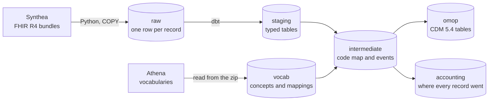

# FHIR to OMOP

Turns health records in FHIR, the format systems use to exchange them, into the OMOP Common Data Model, the format researchers use to analyse them. Every record is accounted for, so the output can be trusted before anyone asks a question of it.

All patients are synthetic, generated by [Synthea](https://github.com/synthetichealth/synthea). No real patient data is used anywhere.

> **Status.** The pipeline runs from raw FHIR to OMOP 5.4 for 1,133 synthetic patients. Federated learning across simulated NHS trusts is next.

## Results

| Measure | Result |
|---|---|
| FHIR records in the source files | 1,400,153 |
| Records in Postgres after loading | 1,400,153 |
| Loaded into OMOP tables | 898,876 |
| Used to read another record | 16,351 |
| Left out, each type with a written reason | 484,926 |
| Clinical rows on a standard concept | 99.86% |
| Distinct codes on a standard concept | 1,154 of 1,180 |

## How it works



**Raw.** Each record is stored as published, with one row per bundle entry. A file is replaced in one transaction, so a rerun gives the same table, and a file only counts as loaded when the row count in Postgres matches the count in the file.

**Vocabularies.** The Athena download is 4.9 GB unzipped and most of it covers vocabularies this data never uses. The loader reads straight from the zip and keeps only what is needed, so nothing is unpacked to disk.

**Mapping.** Each source code becomes the standard OMOP concept it maps to. A code with no standard concept stays in its table with concept 0 and its original code, so the fact is not lost.

**Routing.** OMOP places a record by what its concept is, not by what FHIR called it. In this data, 21,523 "conditions" are really observations, such as employment status, and 302 "procedures" are really drugs given, mostly vaccines. Allergies are the exception. An allergy's code names the substance, so routing by concept would record a penicillin allergy as a dose of penicillin. Every allergy goes to the observation table instead, with the substance as its value.

**Accounting.** Every FHIR resource type is loaded, used to read another record, or left out with a reason. A new type with no decision fails the build, and so does a loaded type that loses rows.

## Repository

```
src/fhir_to_omop/   the FHIR loader and the vocabulary loader
sql/                raw and vocabulary tables, and the official OMOP definition, kept for testing
dbt/                staging, intermediate and OMOP models, with their tests
tests/              Python tests, including a column-by-column check against the OMOP standard
```

## Run it

You need Docker, Python 3.12 and a free [Athena](https://athena.ohdsi.org) account.

1. Copy `.env.example` to `.env`, then start Postgres with `docker compose up -d --wait`.
2. Install the tools with `pip install -e ".[dev]"`.
3. Generate patients with Synthea, using seed 42, and load them with `python -m fhir_to_omop.load <folder of FHIR bundles>`.
4. In Athena, download SNOMED, LOINC, RxNorm and CVX, then load them with `python -m fhir_to_omop.vocabulary <path to the zip>`. UCUM and the type vocabularies come with every download.
5. From `dbt/`, set `DBT_PROFILES_DIR=.` and run `dbt build`.
6. Run the Python tests with `pytest`.

The vocabularies stay out of this repo, because Athena's licence terms apply to them. Each user downloads their own copy.

## Limitations

- Synthea writes US data, so drugs use RxNorm and vaccines use CVX. A real NHS deployment would start from SNOMED CT UK and dm+d.
- FHIR gives no end date for a prescription here, so `drug_exposure` shows that a drug was prescribed, not how long it was taken.
- Provider and care site tables aren't built.
- US billing records and free text notes are left out.
- 118 visits fall after a patient's death. They are paperwork visits for the death certificate, so they stay, and a test blocks anything else from appearing after death.
